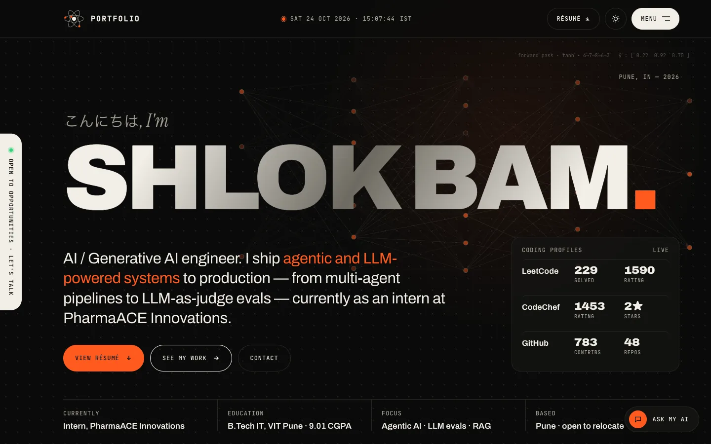
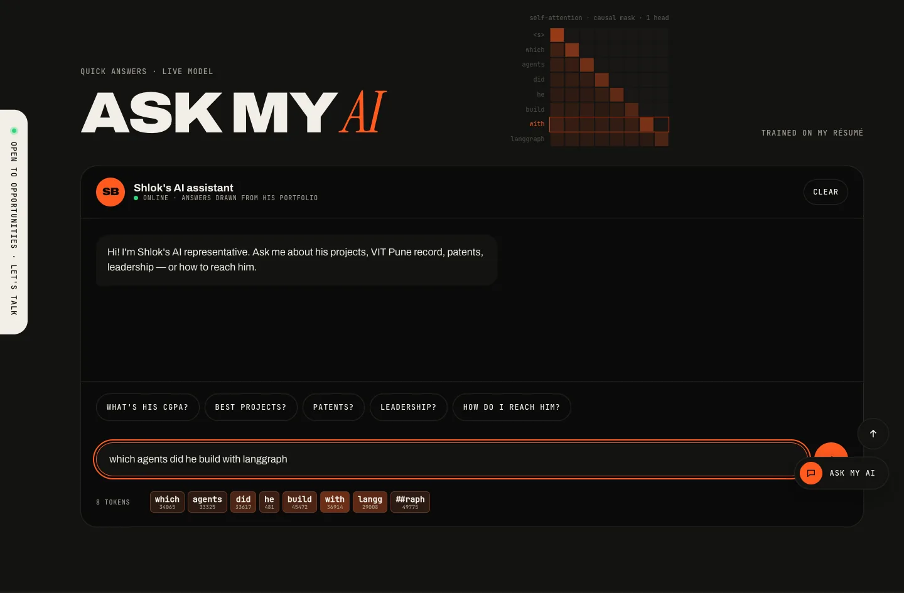
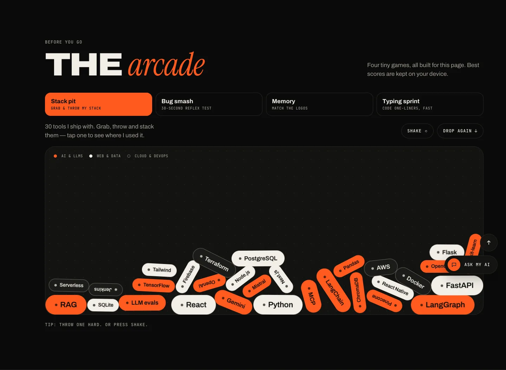
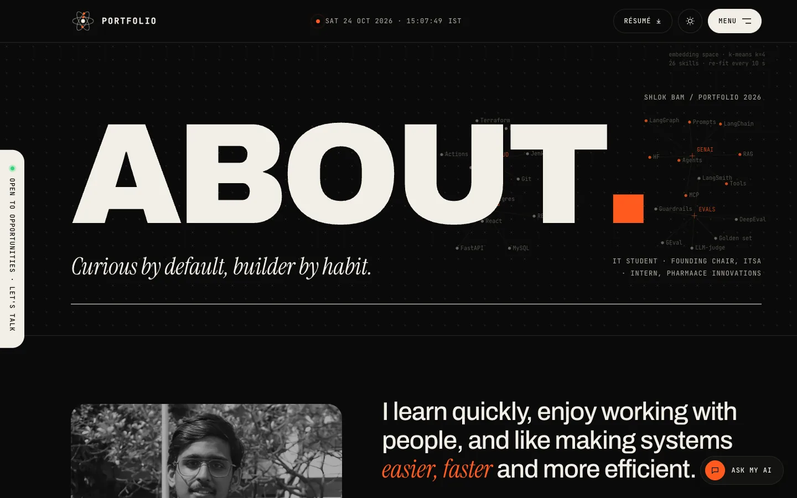
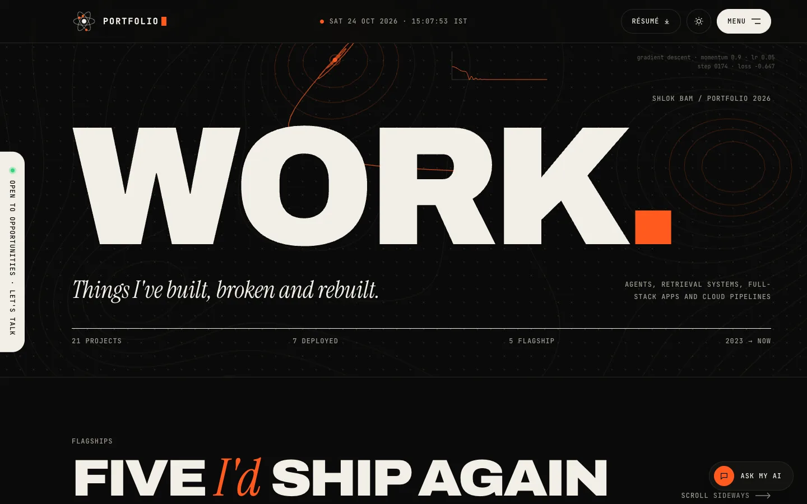
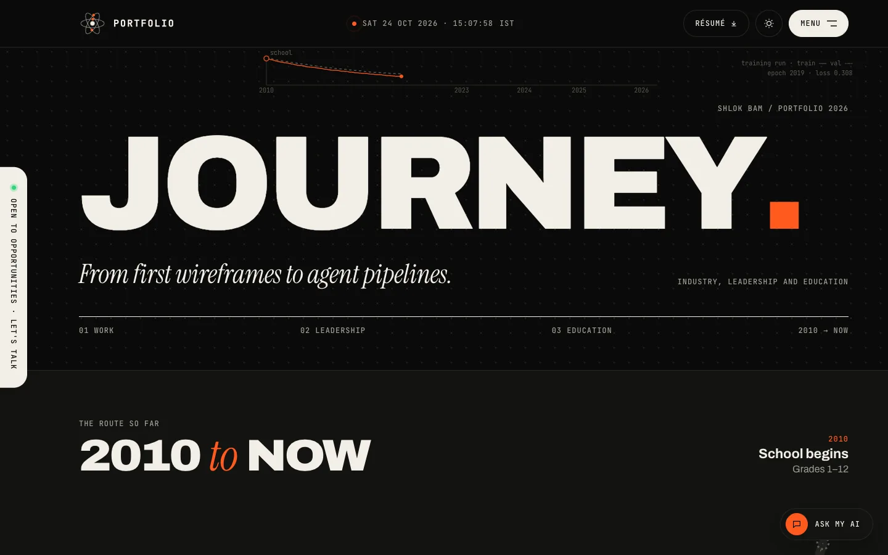
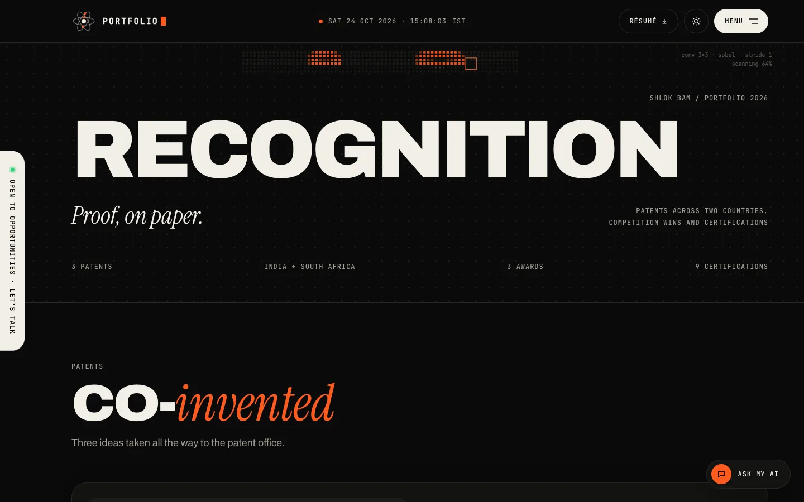
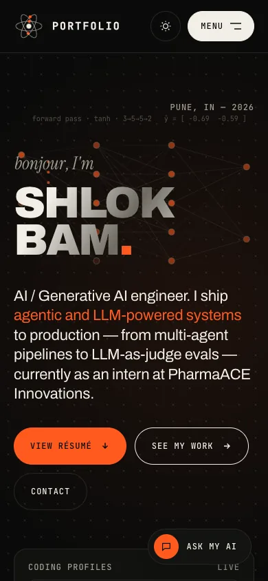
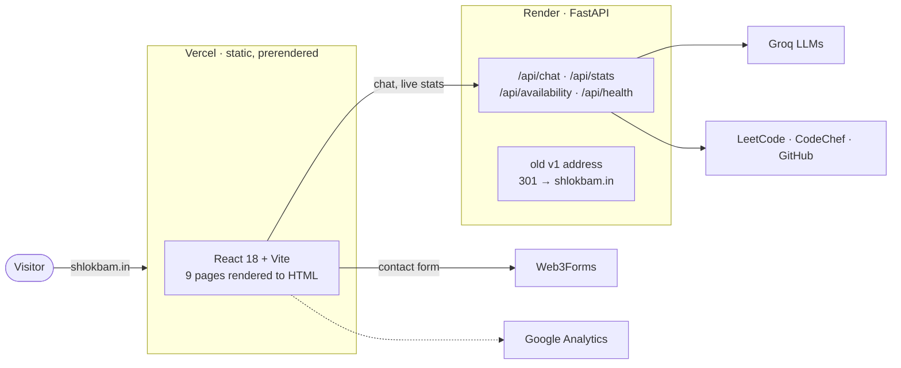

<div align="center">


# Shlok Bam — Portfolio

**AI / Generative AI engineer · Pune, India**

A portfolio that behaves like the work it shows: real neural nets, gradient descent and self-attention
running live behind every page, an AI assistant trained on my résumé, and a small arcade at the end.

[](https://shlokbam.in)
&nbsp;
[](https://shlokbam.in/static/Resume/Shlok_Bam_Resume.pdf)


<br />



</div>

---

## ✦ What's inside

<table>
<tr>
<td width="50%" valign="top">

### 🧠 Live AI on every page
Each page header runs a small, **real computation** on a canvas: not a looping video, but the actual maths.

| Page | Runs live |
|---|---|
| Home | Feed-forward net, tanh forward pass; input follows your pointer |
| About | k-means over a skill-embedding space, re-fit every 10 s |
| Work | Gradient descent with momentum on a 2-D loss surface |
| Journey | Train / validation loss curve, years as epochs |
| Recognition | 3×3 Sobel convolution scanning a pixel strip |
| Community | Message passing over a k-NN graph |
| Writing | Next-token sampling with attention arcs |
| Case study | The DailyDiff agent pipeline, step by step |

</td>
<td width="50%" valign="top">

### 💬 Ask my AI
A portfolio assistant that knows everything on the site, served by FastAPI and Groq.

- The question is **tokenised live** as you type, with token ids.
- A **causal self-attention heatmap** of your question renders behind it.
- Replies **stream in**, and a small network "thinks" while waiting.
- It **falls back across models** when one is rate-limited, and has prepared answers if the API is asleep.



</td>
</tr>
</table>

### 🕹️ The arcade
Four tiny games, all built for the contact page. Best scores stay on your device.

| Game | What you do |
|---|---|
| **Stack pit** | Grab, throw and stack my 30 tools as physical pills (matter-js, lazy-loaded) |
| **Bug smash** | A 30-second reflex test |
| **Memory** | Match the tech logos |
| **Typing sprint** | Type code one-liners against the clock |



### ✨ And the small things
- **Live data:** LeetCode, CodeChef and GitHub numbers, plus a hover peek with a 26-week contribution heatmap.
- **A multilingual hello** that cycles every second, a live IST clock to the second, and a scramble-text logo.
- **Recognition page:** patents and awards as stamped, tilting cards.
- **Journey page:** a route that draws itself as you scroll, from 2010 to now.
- **Work page:** horizontally scrolling flagships, and a project index with rich hover previews.
- **Dark and light themes**, chosen before first paint so there's no flash.
- **Smooth scroll** with Lenis, **scroll-driven CSS animations** in Chromium and a JS fallback elsewhere, and full **reduced-motion** support.

---

## 📸 Pages

<table>
<tr>
<td></td>
<td></td>
</tr>
<tr>
<td align="center"><sub><b>About</b>: k-means over a skill-embedding space</sub></td>
<td align="center"><sub><b>Work</b>: gradient descent with momentum</sub></td>
</tr>
<tr>
<td></td>
<td></td>
</tr>
<tr>
<td align="center"><sub><b>Journey</b>: a training run, years as epochs</sub></td>
<td align="center"><sub><b>Recognition</b>: a Sobel convolution scanning pixels</sub></td>
</tr>
</table>

<div align="center">

<br /><sub>Designed down to 320 px wide</sub>
</div>

---

## 🏗️ Architecture



- **The site is static.** Every route is prerendered to real HTML at build time, with its own title, description, canonical URL, Open Graph tags and JSON-LD. It loads instantly from Vercel's CDN, even while the API sleeps.
- **The API is small.** FastAPI handles the assistant (system prompt built from [`knowledge.py`](v2/backend/knowledge.py)), cached coding stats and a health check. It also redirects the old Render address to the new domain and retires v1's service worker.
- **The contact form** posts straight from the browser to Web3Forms, with a honeypot field for bots.

---

## 🧰 Stack

| Layer | Tools |
|---|---|
| Front end | React 18, React Router 6, Vite 5, Lenis, matter-js, simple-icons, hand-written CSS (no UI kit) |
| Rendering | Vite SSR build + a prerender script → static HTML, sitemap, robots.txt and a real 404 |
| Visuals | Canvas 2D scenes, CSS `animation-timeline`, container-query units, `@property` animations |
| Back end | Python 3.11, FastAPI, httpx, Groq (OpenAI-compatible API) |
| Hosting | Vercel (site) · Render (API) · GoDaddy DNS → `shlokbam.in` |
| Fonts | Archivo, JetBrains Mono, Instrument Serif, Mrs Saint Delafield, all self-hosted |

---

## 📁 Structure

```text
.
├── v2/
│   ├── frontend/                 → Vercel (root directory: v2/frontend)
│   │   ├── src/
│   │   │   ├── pages/            one component + stylesheet per page
│   │   │   ├── components/       Layout, AskAI, ChatWidget, Arcade, SkillPit, ProfilePeek, …
│   │   │   │   └── arcade/       Bug smash, Memory, Typing sprint
│   │   │   ├── lib/scenes/       the live AI canvases (nn, embed, gd, attention, cv, …)
│   │   │   ├── data/projects.js  the 21 projects
│   │   │   └── seo.js            per-page titles, descriptions, structured data
│   │   ├── public/static/        résumé, certificates, patents, photos (+ WebP copies in opt/)
│   │   └── scripts/prerender.mjs
│   ├── backend/                  → Render (root directory: v2/backend)
│   │   ├── main.py               API, stats fetchers, redirects
│   │   └── knowledge.py          everything the assistant knows
│   └── README.md                 developer notes
└── docs/screens/                 the images in this README
```

---

## 🚀 Run it locally

```bash
# 1. API: reads GROQ_API_KEY and WEB3FORMS_ACCESS_KEY from the repo-root .env
cd v2/backend
python3.11 -m venv .venv && .venv/bin/pip install -r requirements.txt
.venv/bin/uvicorn main:app --reload --port 8000

# 2. Site: proxies /api to :8000
cd v2/frontend
npm install
npm run dev          # http://localhost:5173
```

| Command | What it does |
|---|---|
| `npm run build` | Builds the app, prerenders every page and writes the sitemap and 404 |
| `npm run preview` | Serves `dist/` the way Vercel does |

Deployment settings for Render and Vercel are in **[v2/README.md](v2/README.md#deploy)**.

---

## 📬 Say hi

<div align="center">

**[shlokbam.in](https://shlokbam.in)** · [LinkedIn](https://www.linkedin.com/in/shlokbam/) · [GitHub](https://github.com/shlokbam) · [X](https://x.com/shlok_bam) · [shlokbam19103@gmail.com](mailto:shlokbam19103@gmail.com)

<sub>Designed and built by Shlok Bam. Earlier version: Flask (v1), kept in this repo's git history.</sub>

</div>
