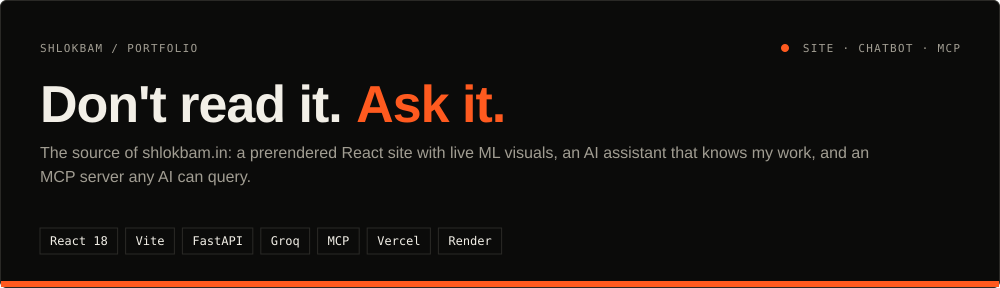
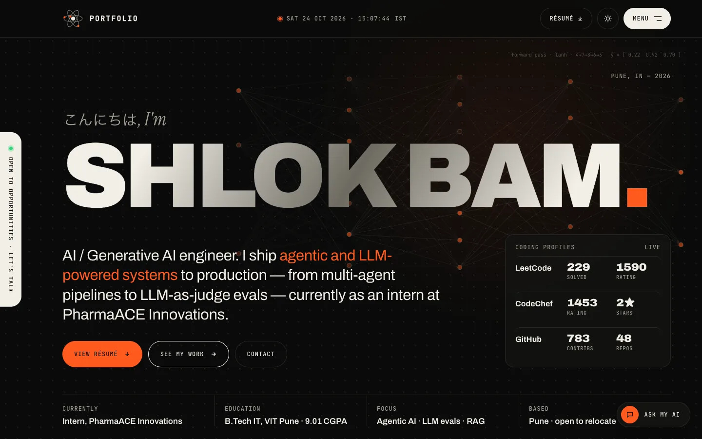
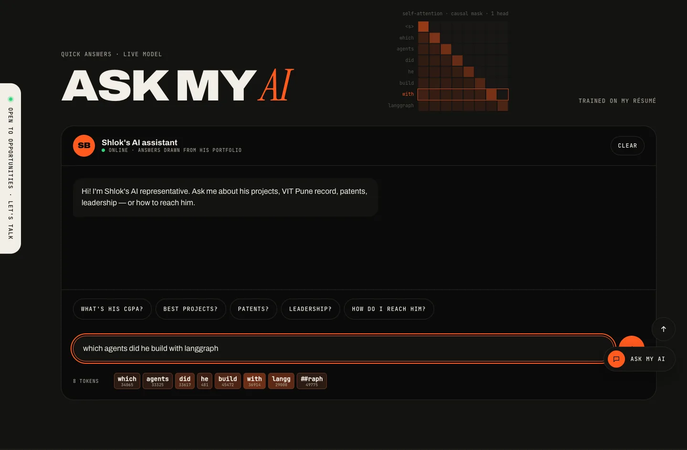
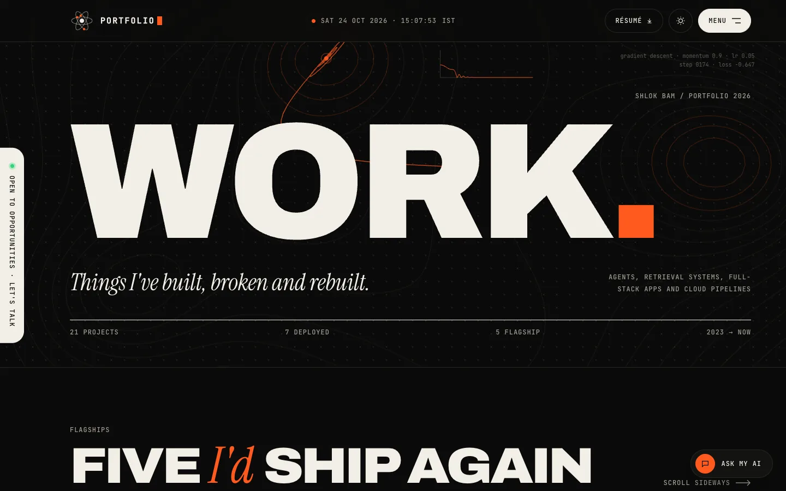
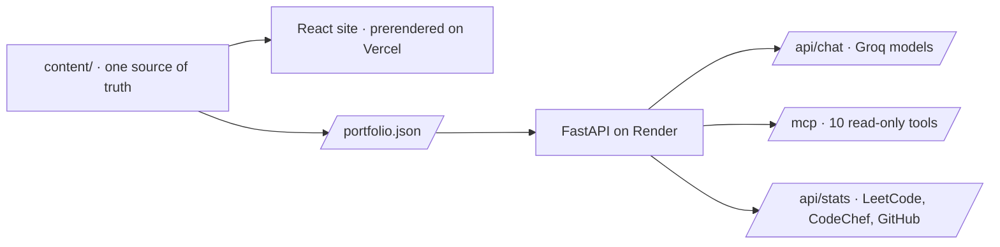
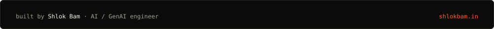

<div align="center">




<a href="https://shlokbam.in">Live site</a> · <a href="https://shlokbam.in/ai">Ask my AI</a> · <a href="#how-it-works">How it works</a> · <a href="#quickstart">Quickstart</a> · <a href="#design-decisions">Decisions</a> · <a href="docs/DETAILS.md">Full tour</a>

</div>

## In one minute

- **Problem:** a portfolio is a page people skim. Recruiters and engineers increasingly ask an AI instead.
- **What this does:** one content file feeds three things: the website, its chat assistant, and an MCP server at `shlokbam.in/mcp` that Claude, ChatGPT, Cursor or VS Code can call.
- **Result:** listed on the official MCP Registry. Glama rates its tool definitions 4.6/5 (all 10 graded A), and mcptry scores it 99/100.

## Demo



<table>
<tr>
<td></td>
<td></td>
</tr>
<tr>
<td align="center"><sub><b>Ask my AI</b>: live tokeniser and attention heatmap</sub></td>
<td align="center"><sub><b>Work</b>: gradient descent with momentum</sub></td>
</tr>
</table>

**Ask it from your own AI.** In Claude: Settings → Connectors → Add custom connector → `https://shlokbam.in/mcp`. Steps for ChatGPT, Cursor and VS Code: [shlokbam.in/ai](https://shlokbam.in/ai).

## How it works



| Part | What it does |
| :--- | :--- |
| `v2/frontend/src/content/` | Everything the site says, as data; published as `/portfolio.json` |
| `v2/frontend/src/lib/scenes/` | The live canvases: neural net, k-means, gradient descent, attention, Sobel |
| `v2/backend/main.py` | API: chat with model fallback, cached coding stats, redirects |
| `v2/backend/mcp_server.py` | MCP server: profile, projects, experience, skills, patents, writing, search |
| `v2/backend/server.json` | MCP Registry entry (`io.github.shlokbam/portfolio`) |

## Quickstart

```bash
# API: reads GROQ_API_KEY and WEB3FORMS_ACCESS_KEY from the repo-root .env
cd v2/backend
python3.11 -m venv .venv && .venv/bin/pip install -r requirements.txt
.venv/bin/uvicorn main:app --reload --port 8000

# Site: proxies /api to :8000
cd v2/frontend && npm install && npm run dev     # http://localhost:5173
```

`npm run build` prerenders every page, the sitemap and the 404. Deploy settings: [v2/README.md](v2/README.md#deploy).

## Design decisions

- **Static first.** Every route is prerendered to real HTML with its own meta tags and JSON-LD, so the site loads from the CDN even when the API is asleep.
- **One content file.** The site, chatbot and MCP server read the same data, so they can never disagree about a project or a number.
- **Read-only MCP, stateless HTTP.** No sign-in, no sessions to lose on a free host, and nothing a caller can change. The tool descriptions were rewritten twice after watching how agents pick tools.
- **Real maths, not videos.** Each page header runs its algorithm live on a canvas, with full reduced-motion support.

## Limits & roadmap

- [ ] The API sleeps on Render's free tier; the chat falls back to prepared answers until it wakes
- [ ] Add usage numbers for the MCP server (calls per week) without logging what people ask

---

<div align="center">

<a href="https://shlokbam.in"></a>

<a href="https://shlokbam.in">shlokbam.in</a> · <a href="https://www.linkedin.com/in/shlokbam/">LinkedIn</a> · <a href="https://github.com/shlokbam">More projects</a>

</div>
